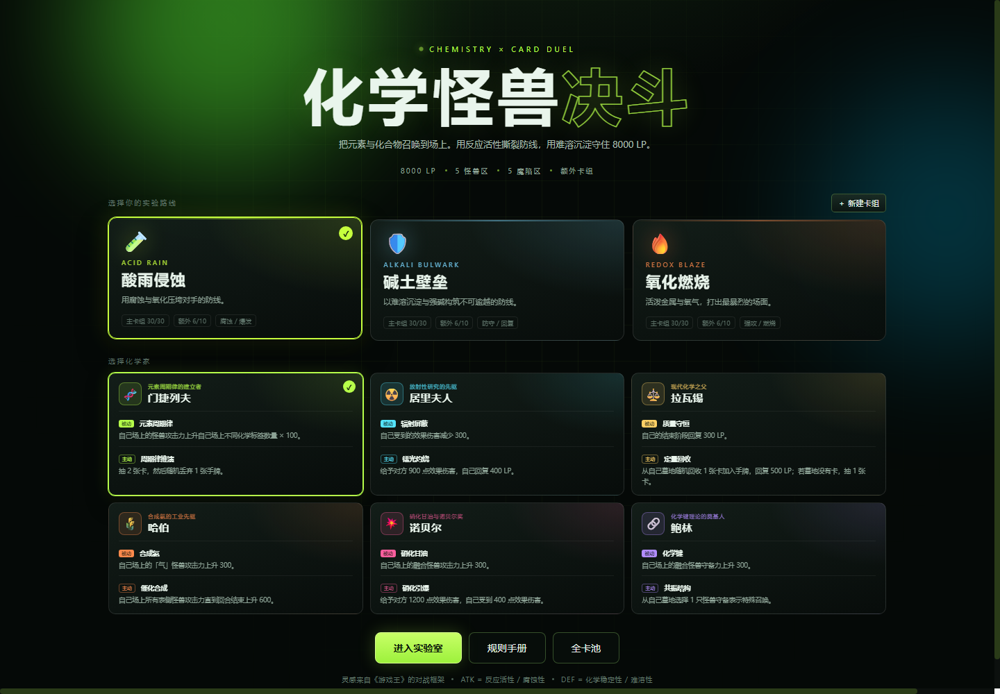
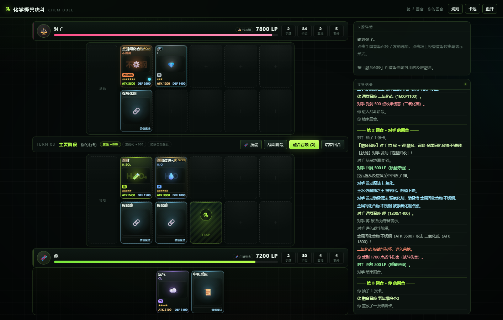

# 化学怪兽决斗 · Chemistry Duel

一款以《游戏王》为对战框架、以化学元素与化合物为卡牌原型的浏览器卡牌游戏。双方 **8000 LP**，各有 **5 个怪兽区 / 5 个魔法·陷阱区 / 1 个场地魔法区 / 6 张额外卡组**；卡池收录 82 种代表性单质与化合物，每一种都被具象化为拥有 **ATK（反应活性 / 腐蚀性 / 氧化性）**、**DEF（化学稳定性 / 难溶性 / 惰性）** 与 **化学标签（酸 / 碱 / 盐 / 活泼金属 / 水 / 气 / 固）** 的怪兽。开局还要选择一位**化学家**：被动能力自动生效，主动技能每场决斗可发动一次。角色技能框架参考《游戏王 Duel Links》的化学家技能设计。你可以使用预设卡组，也可以在「新建卡组」中自由构筑；每回合抽 2 张卡（先攻第 1 回合不抽）。

打开 [`index.html`](index.html) 即可游玩，无需服务器、无需安装依赖。推荐 Chrome / Edge。

- GitHub：[NagasakiSaki/chemistry-duel](https://github.com/NagasakiSaki/chemistry-duel)
- 在线试玩：[nagasakisaki.github.io/chemistry-duel](https://nagasakisaki.github.io/chemistry-duel/)
- 开发文档：[DEVELOPMENT.md](DEVELOPMENT.md)
- 完整卡表：[CARD_LIST.md](CARD_LIST.md)；卡组构成：[DECK_LISTS.md](DECK_LISTS.md)；化学家：[CHEMISTS.md](CHEMISTS.md)





---

## 1. 直接开始

```text
chemistry-duel/
  index.html          ← 双击打开
  css/style.css
  js/engine.js        ← 规则引擎（无 DOM，可在 Node 中测试）
  js/cards.js         ← 135 张卡牌数据库
  js/chemists.js      ← 6 位化学家、被动能力与主动技能
  js/decks.js         ← 三套 40 张主卡组 + 6 张额外卡组
  js/content.js       ← 内容注册表 / 扩展入口
  js/expansions/      ← 后续扩展包（模板与说明）
  js/ai.js            ← 对手 AI（含化学家技能决策）
  js/ui.js            ← 浏览器界面、卡组构筑器、交互
  test/               ← 规则 / 效果 / 化学家测试与文档生成器
  README.md
  DEVELOPMENT.md      ← 开发文档
  CARD_LIST.md        ← 自动生成的全卡表
  DECK_LISTS.md       ← 三套卡组的逐卡构成
  CHEMISTS.md         ← 化学家技能表
  LICENSE
```

也可以在本目录启动任意静态服务器：

```bash
python -m http.server 8000
# 打开 http://127.0.0.1:8000
```

直接 `file://` 打开也可以，因为项目使用传统 `<script>` 加载，不依赖 ES Module 或网络资源。

---

## 2. 核心玩法

### 2.1 胜利条件

- 将对方 LP 从 **8000** 降至 0。
- 让对方 **卡组耗尽**（无法抽卡）。

### 2.2 回合流程

1. **抽卡阶段**：抽 2 张。先攻的第 1 回合不抽卡，也不能攻击。
2. **主要阶段**：
   - 通常召唤 / 盖放 **1 次**；
   - 发动魔法卡；
   - 盖放陷阱卡；
   - **融合召唤 1 次**；
   - 改变怪兽表示形式。
3. **战斗阶段**：每只表侧攻击表示的怪兽可以攻击 1 次。
4. **结束阶段**：处理结束阶段效果，交给对手。

### 2.3 召唤规则

| 等级 | 祭品 |
|---|---|
| Lv.1–4 | 不需要 |
| Lv.5–6 | 1 只 |
| Lv.7–8 | 2 只 |

盖放怪兽算作当回合的通常召唤，以背面守备表示放置；被攻击时翻开。每只怪兽每回合可以改变 1 次表示形式。

### 2.4 融合召唤 · 化学反应

融合召唤 **不需要「融合」魔法卡**，每回合 1 次：

1. 从手牌或自己场上选择满足 **标签素材** 的怪兽；
2. 将它们送入墓地；
3. 从额外卡组特殊召唤对应的融合怪兽。

融合只看 **化学标签**，不看具体卡名。双标签怪兽（如氢氧化铝同时是「碱」和「酸」）可以充当其中一种素材。

| 融合怪兽 | 素材 | 定位 |
|---|---|---|
| 王水·强腐蚀之王 | 酸 ×2 | 攻击时直接溶解「固」/「活泼金属」 |
| 中和产物·氯化钠 | 酸 + 碱 | 回复 1000 LP，抽 1 |
| 重晶石·硫酸钡 | 盐 ×2 | 3200 DEF，战斗免疫 + 耐酸 |
| 强碱之王·氢氧化铯 | 碱 ×2 | 回复 1500 LP，碱类光环 |
| 氢氧爆鸣·水 | 气 ×2 | 召唤时破坏 + 500 烧伤 |
| 充分燃烧·二氧化碳 | 气 + 固 | 800 烧伤 + 抽 1 |
| 锈蚀·氧化铁 | 活泼金属 + 气 | 全体削防 |
| 金属间化合物·不锈钢 | 活泼金属 ×2 | 战斗免疫 |
| 电解产物·氯气 | 盐 + 水 | 全体削攻 |
| 光合作用·葡萄糖 | 水 + 气 | 每回合回复 800 |
| 硅酸盐·玻璃 | 固 + 盐 | 效果免疫，3000 DEF |
| 酸雨·亚硫酸 | 酸 + 气 | 800 烧伤 + 酸类光环 |
| 光气·COCl₂ | 气 ×2 | 全体削攻 + 300 烧伤 |
| 硝化甘油 | 酸 + 气 | 1200 烧伤，结束阶段自毁 |
| 酸酐·三氧化硫 | 气 ×2 | 600 烧伤 + 全体削防 |
| 皂化反应·硬脂酸钠 | 碱 + 盐 | 回复 + 全体削攻 |
| 水化硅酸钙·水泥 | 盐 ×2 | 效果免疫，3000 DEF |
| 缓冲体系·碳酸氢钠 | 碱 + 盐 | 回复 1000 |
| 过氧化钠·强氧化 | 活泼金属 + 气 | 破坏 + 500 烧伤 |
| 刚玉·氧化铝 | 活泼金属 + 气 | 效果免疫，3000 DEF |

### 2.5 战斗

- 攻击表示 vs 攻击表示：攻击力低的一方破坏，差值成为战斗伤害；相等则双方破坏。
- 攻击守备表示：攻击力 > 守备力则破坏目标，通常不造成伤害；攻击力 < 守备力则攻击方受到差值反伤。
- 有「贯通」的怪兽攻击守备表示时，差值仍会造成伤害。
- 对方场上没有怪兽时可以直接攻击。

### 2.6 化学标签与全局反应

| 反应 | 规则 |
|---|---|
| **腐蚀** | 「酸」怪兽攻击「活泼金属」怪兽时，攻击力 **+800**。 |
| **中和** | 「酸」与「碱」怪兽战斗后，双方怪兽破坏，双方各回复 **500 LP**。 |
| **溶剂化** | 自己场上有表侧「水」怪兽时，自己的「酸」「碱」怪兽攻击力 **+300**。 |

这些规则与卡牌效果叠加。例如「稀盐酸」装备后会让装备怪兽获得「酸」标签，从而触发腐蚀与中和。

### 2.7 魔法与陷阱

- 魔法卡只能在自己的主要阶段从手牌发动；装备魔法附着在怪兽上，怪兽离场时装备送入墓地。
- 陷阱卡先盖放，**从下一个回合开始**在满足条件时自动发动；每次触发事件最多发动 1 张陷阱。
- 永续陷阱会在自己下一个回合开始时自动翻开。
- 陷阱的自动触发减少操作负担，也让「读牌」与盖放时机仍然重要。

### 2.8 自由构筑

标题界面提供「新建卡组」入口：从 135 张卡中自由选择 **40 张主卡组 + 0–6 张额外卡组**，同名卡最多 3 张。自定义卡组保存在浏览器 `localStorage`，可反复编辑、删除并直接用于决斗。

### 2.9 化学家与技能

参考 Duel Links 的角色技能框架：开局在标题界面选择 1 位化学家。每位化学家有 **1 个被动能力**（自动生效）和 **1 个主动技能**（每场决斗 1 次，主要阶段通过战斗条上的「技能」按钮发动）。完整的技能文本见 [`CHEMISTS.md`](CHEMISTS.md)。

| 化学家 | 被动 | 主动 |
|---|---|---|
| 🧬 门捷列夫 | 自己场上每有 1 种不同标签，己方怪兽 ATK +100 | 抽 2 张，随机弃 1 张 |
| ☢️ 居里夫人 | 自己受到的效果伤害 -300 | 对方受到 900 伤害，自己回复 400 LP |
| ⚖️ 拉瓦锡 | 自己的结束阶段回复 300 LP | 从墓地回收 1 张卡，回复 500 LP |
| 🌾 哈伯 | 自己的「气」怪兽 ATK +300 | 己方表侧怪兽攻击力直到回合结束 +600 |
| 💥 诺贝尔 | 自己的融合怪兽 ATK +300 | 对方受到 1200 伤害，自己受到 400 伤害 |
| 🔗 鲍林 | 自己的融合怪兽 DEF +300 | 从墓地守备表示特殊召唤 1 只怪兽 |

对手会从其余化学家中随机选择一位，并在自己的回合自动评估是否使用技能。技能是「角色 + 卡组」组合策略的一部分：例如门捷列夫适合多标签铺场，诺贝尔适合融合爆发，居里夫人适合对抗烧血。

---

## 3. 三套预设卡组

### 酸雨侵蚀 · ACID RAIN

高攻酸类与气体，靠腐蚀、战斗追加伤害与「王水」溶解终结对手。代表卡：硫酸、硝酸、氢氟酸、二氧化硫、氯气、氟气。

### 碱土壁垒 · ALKALI BULWARK

碱与盐的高守备阵线，靠回复 LP、削弱对方、自动陷阱和难溶沉淀拖垮对手。代表卡：氢氧化钠、氢氧化钡、硫酸钡、氯化银。

### 氧化燃烧 · REDOX BLAZE

活泼金属 + 氧气/氯气铺场，「氧气」光环强化金属，「燃烧」制造爆发，融合「氢氧爆鸣」与「过氧化钠」瞬间清场。代表卡：镁、铝、钠、钾、氧气、臭氧。

对手会从另外两套中随机选择一套，因此每次开局的对局路线都不同。

---

## 4. 化学 → 数值的设计口径

| 游戏概念 | 化学含义 | 例子 |
|---|---|---|
| **高 ATK** | 反应活性、腐蚀性、氧化性 | 氟气 2800、王水 3500、浓硫酸 2200 |
| **高 DEF** | 化学稳定性、难溶性、惰性 | 硫酸钡 3000、玻璃 3000、金 2100 |
| **酸** | 质子酸 / 腐蚀性 | HCl、H₂SO₄、HF |
| **碱** | 强碱 / 碱性氧化物水合物 | NaOH、KOH、Ba(OH)₂ |
| **盐** | 离子化合物 / 沉淀 | NaCl、BaSO₄、AgCl |
| **活泼金属** | 金属活动性顺序靠前 | Na、K、Ca、Mg、Al、Zn |
| **水** | 溶剂 / 反应介质 | H₂O、H₂O₂、乙醇 |
| **气** | 气体单质 / 气体氧化物 | O₂、Cl₂、SO₂、CO₂ |
| **固** | 固体单质 / 难溶固体 | C、Si、SiO₂、Fe₂O₃ |

一些刻意保留的化学梗：

- **硫酸钡 / 氯化银 / 金 / 铅** 拥有耐酸防护；
- **王水** 可以绕过耐酸防护，直接溶解金与固体；
- **氢氟酸** 对「固」怪兽有额外攻击力（腐蚀玻璃）；
- **钠、钙、三氧化硫** 遇到「水」会额外灼伤；
- **氢氧化铝** 是双标签（两性）；
- **硫酸铜** 遇到水会抽卡（无水硫酸铜遇水变蓝）；
- **过氧化钠** 遇到水会从卡组特殊召唤氧气；
- **浓硫酸** 的战斗伤害会追加 500（脱水腐蚀）；
- **硝酸** 拥有贯通（强氧化性）；
- **硝化甘油** 爆发极高，但结束阶段自毁。

> 说明：这是以化学为灵感的对战游戏，不是化学计量模拟器。部分数值与效果为了节奏、平衡和可玩性做了夸张与简化。

---

## 5. 操作说明

1. 在标题界面选择一套卡组和一位化学家，点击「进入实验室」；也可以点击「新建卡组」自由构筑，自定义卡组会保存在本地。
2. 点击手牌 → 右侧详情面板出现「通常召唤 / 盖放 / 发动 / 盖放陷阱」等按钮。
3. 需要祭品时，会弹出祭品选择窗口；勾选足够数量后确认。
4. 点击「融合召唤」查看当前可融合的额外卡组怪兽与自动选中的素材。
5. 进入战斗阶段后，点击自己的攻击表示怪兽 → 「攻击」→ 点击高亮敌方怪兽；对方空场时直接攻击。
6. 点击战斗条上的「技能」查看自己的被动与主动技能；主动技能每场决斗限 1 次。
7. 点击「结束回合」后，AI 会自动行动；右上角会显示当前回合与阶段。
8. 点击 HUD 上的「卡组 / 墓地 / 额外」可以查看对应区域；对手的卡组内容不公开。
9. 移动端：选中卡牌后，详情会以底部抽屉弹出。

快捷键：`Esc` 关闭弹窗 / 取消选择。

---

## 6. 运行测试

项目不依赖 npm 包。使用 Node.js 18+：

```bash
node test/rules.test.js     # 13 项规则断言
node test/effects.test.js   # 135 张卡的效果冒烟测试
node test/chemists.test.js  # 14 项化学家与技能断言
node test/simulate.js       # AI vs AI 压测（120 局，含技能）
node test/gen-cards.js      # 重新生成 CARD_LIST.md
node test/gen-decks.js      # 重新生成 DECK_LISTS.md
node test/gen-chemists.js   # 重新生成 CHEMISTS.md
```

`test/rules.test.js` 覆盖：

- 酸 vs 活泼金属的腐蚀 +800；
- 酸碱中和双方破坏与回复；
- 融合素材判定；
- 祭品召唤；
- 陷阱无效攻击；
- 装备赋予「酸」标签；
- 战斗免疫；
- 场地魔法静态加成；
- 卡组检索；
- 直接攻击；
- 陷阱无效魔法；
- 贯通伤害。

`test/chemists.test.js` 覆盖 6 位化学家的被动数值与主动技能，包括效果伤害减免、结束阶段回复、技能次数限制与墓地复活。

`test/simulate.js` 使用三套卡组与随机化学家循环对战。最近一次结果：**120 局全部完成，0 个运行时错误，平均约 12 个玩家回合**。胜负会随卡组、化学家、先攻与抽卡略有波动，可在 `js/ai.js`、`js/cards.js` 和 `js/chemists.js` 中继续调参。

浏览器界面使用原生 DOM，无构建步骤。

---

## 7. 扩展内容

### 7.1 直接扩展核心

在 [`js/cards.js`](js/cards.js) 中添加一条定义即可。

怪兽：

```js
M('NH4Cl', '氯化铵', 'NH₄Cl', ['盐'], 3, 1000, 1500,
  '①：此卡召唤成功时，回复 300 LP。',
  { onSummon(g, self) { g.heal(self.controller, 300, '氯化铵'); } });
```

融合怪兽：

```js
F('fusion_demo', '示例融合', 'X', ['盐'], 6, 2400, 2400,
  [{ tag: '酸', count: 1 }, { tag: '碱', count: 1 }],
  '「酸」+「碱」。①：融合召唤成功时抽 1 张卡。',
  { onSummon(g, self) { g.draw(self.controller, 1); } });
```

然后把卡 ID 加入 [`js/decks.js`](js/decks.js) 的 `main` 或 `extra` 数组（同一张卡最多 3 张）。运行 `node test/gen-cards.js` 重新生成卡表。

### 7.2 以扩展包方式更新（推荐）

后续新增卡牌、卡组、化学家时，不需要改 UI 或引擎，使用 [`js/content.js`](js/content.js) 的注册表：

```js
ChemContent.registerExpansion({
  id: 'pack-02-electro',
  name: '电化学时代',
  cards: { NEW_CARD: { /* 卡牌定义 */ } },
  decks: { electro: { /* 40+6 卡组 */ } },
  deckOrder: ['electro'],
  chemists: { faraday: { /* 化学家定义 */ } },
  chemistOrder: ['faraday']
});
```

在 `index.html` 中把扩展脚本放在 `js/content.js` 之后、`js/ui.js` 之前即可。完整模板与约定见 [`js/expansions/README.md`](js/expansions/README.md) 与 [`js/expansions/_template.js`](js/expansions/_template.js)。

### 7.3 扩展化学家

化学家定义在 [`js/chemists.js`](js/chemists.js)。被动能力是数据字段，主动技能是 `actives` 数组中的函数：

```js
C({
  id: 'faraday', name: '法拉第', title: '电磁感应与电化学', icon: '🔋',
  color: '#55e5ff',
  passive: { name: '电解定律', text: '己方「盐」怪兽攻击力 +200。', tagAtk: { 盐: 200 } },
  actives: [{
    id: 'electrolysis', name: '电解', once: 'duel', timing: 'main',
    text: '抽 1 张卡，回复 300 LP。',
    aiUse(g, p) { return true; },
    activate(g, p) { g.draw(p, 1); g.heal(p, 300, '电解'); }
  }]
});
```

可用被动字段：`allAtk`、`allDef`、`tagAtk`、`tagDef`、`fusionAtk`、`fusionDef`、`atkPerDistinctTag`、`defPerDistinctTag`、`effectDamageReduction`、`endHeal`、`startingLP`、`startingHand`。主动技能支持 `once: 'duel' | 'turn'`、`timing: 'main' | 'battle' | 'any'`、`condition`、`cost`、`aiUse`、`aiTiming`。

运行 `node test/gen-chemists.js` 重新生成 [`CHEMISTS.md`](CHEMISTS.md)。

### 可用效果钩子

| 钩子 | 触发时机 |
|---|---|
| `onSummon(g, self)` | 召唤 / 特殊召唤 / 融合召唤成功 |
| `onDestroyed(g, self, opts)` | 被破坏送入墓地 |
| `onBattleDamage(g, self, target)` | 此卡给予对方战斗伤害 |
| `onBattleDestroy(g, self, target)` | 此卡战斗破坏对方怪兽 |
| `beforeDamage(g, self, target)` | 攻击宣言后、伤害计算前；返回 `true` 停止战斗 |
| `battleAtk(g, self, target)` | 伤害计算时返回攻击力修正 |
| `staticAtk(g, self, target)` / `staticDef` | 持续数值修正 |
| `aura` | 对己方怪兽的光环（可带 `tags` 过滤） |
| `onTurnStart` / `onEndPhase` | 自己回合开始 / 结束阶段 |
| `immuneBattle` / `immuneEffect` / `acidProof` / `shieldOnce` | 破坏防护 |
| `pierce` | 贯通 |

魔法用 `S(...)`，陷阱用 `T(...)`；陷阱的 `trigger` 支持 `attack`、`spell`、`summon`、`damage` 事件。具体 API 可参考 [`js/engine.js`](js/engine.js) 中的 `Duel` 类。

---

## 8. 项目结构

```
js/engine.js    Duel 类：抽卡、LP、召唤、融合、战斗、陷阱窗口、破坏与效果钩子
js/cards.js     135 张卡：82 怪兽 / 20 融合 / 23 魔法 / 10 陷阱
js/chemists.js  6 位化学家：被动数据 + 主动技能
js/decks.js     酸雨侵蚀、碱土壁垒、氧化燃烧三套 40+6 卡组
js/content.js   卡牌 / 卡组 / 化学家的统一注册表与扩展入口
js/expansions/  扩展包模板与接入说明
js/ai.js        融合、魔法、召唤、盖陷阱、战斗目标选择、技能决策
js/ui.js        渲染、点击交互、弹窗、化学家技能、移动端抽屉
css/style.css   实验室霓虹视觉、卡片、场地、响应式布局
test/           规则 / 效果 / 化学家断言、AI 压测、文档生成器
```

引擎与 UI 分离：`Duel` 不依赖 DOM，可以直接在 Node 中运行完整对局；`ui.js` 只负责渲染和把点击翻译成引擎调用。

---

## 9. 已知简化

- 没有连锁（Chain）系统：陷阱按事件自动触发，每次事件最多 1 张。
- 没有手牌上限与主要阶段 2。
- 化学家主动技能目前都是自动结算，没有额外的目标选择窗口；新增技能可以在 `activate` 中自行扩展。
- 怪兽效果以召唤、战斗、破坏、回合开始/结束等关键节点为主，没有复杂的起动效果。
- 陷阱不区分伤害步骤的多个窗口。
- 化学数值是游戏化抽象，不保证与真实反应热力学/动力学一致。

这些简化是为了让一局控制在 5–10 分钟内，同时保留「资源交换、读牌、融合组合、战斗取舍」的核心乐趣。

---

## 10. 致谢

对战框架参考《游戏王》（Konami / 高桥和希），本项目为独立的化学主题同人玩法实现，不使用其卡图、卡名或素材。所有卡面图形由 CSS 与 Emoji 构成，无外部图片依赖。
